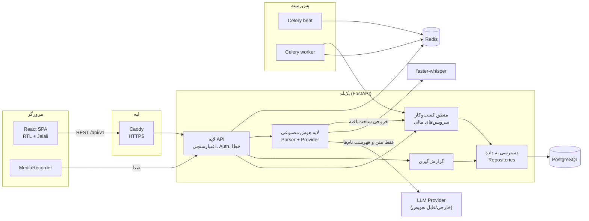
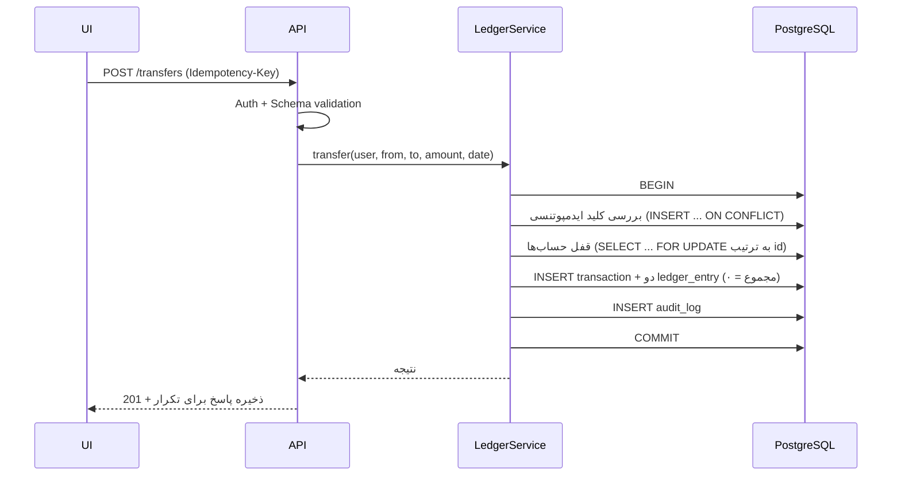
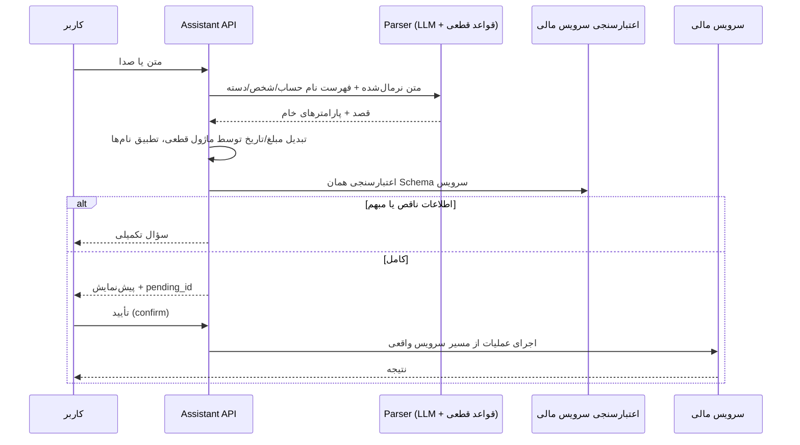

# ۲. معماری سیستم

## ۲.۱ نمای کلی



**قاعده‌های بنیادین:**
- فرانت‌اند مستقیماً به دیتابیس وصل نمی‌شود.
- لایه هوش مصنوعی به دیتابیس دسترسی ندارد؛ فقط خروجی ساخت‌یافته تولید می‌کند و اجرا همیشه از مسیر سرویس‌های مالی است.
- قواعد مالی فقط در لایه منطق کسب‌وکار (و قیود دیتابیس) هستند، نه در فرانت و نه در پاسخ مدل.

## ۲.۲ لایه‌ها و مرز مسئولیت

| لایه | مسئولیت | ممنوعیت‌ها |
|---|---|---|
| UI | نمایش، فرم، اعتبارسنجی اولیه، پیش‌نمایش | محاسبه موجودی/بدهی؛ اتصال به دیتابیس |
| API | Schema (Pydantic)، Auth، مجوز، قالب پاسخ و خطا، Rate limit، Idempotency-Key | منطق مالی |
| منطق کسب‌وکار | قواعد مالی، تراکنش اتمیک، ابطال، ایدمپوتنسی، سابقه تغییرات | وابستگی به FastAPI/HTTP |
| دسترسی به داده | Repository ها، همه کوئری‌ها با `user_id`، قفل ردیف | قاعده کسب‌وکار |
| هوش مصنوعی | تفسیر زبان، استخراج پارامتر، پرسش تکمیلی، تبدیل به Schema | دسترسی دیتابیس؛ محاسبه مالی؛ اجرای مستقل |
| پس‌زمینه | زمان‌بندی، یادآوری، retry، ثبت وضعیت | وابستگی به مرورگر |
| گزارش‌گیری | فقط‌خواندنی؛ محاسبات از ledger | تخمین مدل زبانی |
| امنیت و نظارت | Auth، RLS، لاگ ساختاریافته، audit، متریک | (در همه لایه‌ها اعمال می‌شود) |

## ۲.۳ ساختار پوشه بک‌اند (برای فاز ۱)

```
backend/
├── app/
│   ├── api/v1/            # routerها، dependencyها، schemaهای درخواست/پاسخ
│   ├── core/              # config، security، logging، errors
│   ├── domain/            # Value objectها (Money, JalaliDate)، enumها، قواعد خالص
│   ├── services/          # ledger، debts، cheques، reports، reminders
│   ├── repositories/      # دسترسی به داده (فقط SQL/ORM)
│   ├── models/            # مدل‌های SQLAlchemy
│   ├── assistant/         # parser، providers، entity resolution، preview
│   ├── jobs/              # taskهای Celery
│   └── main.py
├── alembic/
├── tests/{unit,property,integration,api,assistant}
└── pyproject.toml
```

## ۲.۴ جریان ثبت یک عملیات (نمونه: انتقال وجه)



## ۲.۵ جریان دستیار هوشمند



## ۲.۶ استقرار هدف

```
VPS ── Docker Compose
        ├── caddy        (80/443، HTTPS خودکار)
        ├── frontend     (فایل‌های ثابت)
        ├── api          (uvicorn/gunicorn)
        ├── worker       (celery)
        ├── beat         (celery beat، فقط یک نمونه)
        ├── postgres     (volume + بکاپ)
        └── redis
```
Postgres و Redis روی اینترنت باز نمی‌شوند؛ فقط شبکه داخلی Docker.
