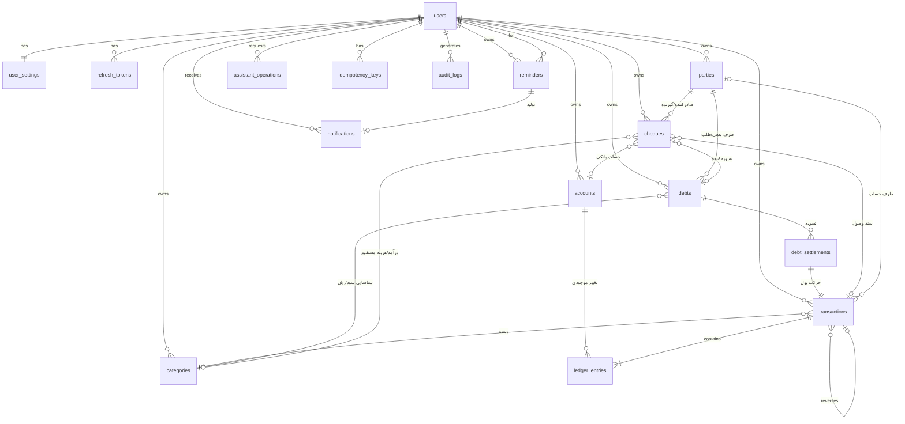

# ۳. مدل داده

## ۳.۱ اصول
1. **مبلغ**: `BIGINT` به **ریال**، همیشه مثبت در ستون‌های «مبلغ». جهت از نوع عملیات یا علامت `ledger_entries.amount_rial` می‌آید. محدوده هر مبلغ: `1 … 10^13` (CHECK).
2. **تاریخ**: روز به‌صورت `DATE` میلادی (ISO). زمان ایجاد رکورد: `TIMESTAMPTZ` (UTC). تبدیل شمسی فقط در مرز ورودی/خروجی (ADR-0005).
3. **کلیدها**: `UUID` (v7 یا v4) برای همه جدول‌ها.
4. **جداسازی کاربران**: هر جدول مالی ستون `user_id` دارد و:
   - `UNIQUE (user_id, id)` روی هر جدول مرجع،
   - کلید خارجی **مرکب** `(user_id, x_id) → x(user_id, id)`؛ یعنی ارجاع به رکورد کاربر دیگر در سطح دیتابیس ممکن نیست،
   - Row Level Security روی همه جدول‌های کاربری (ADR-0010).
5. **حذف ممنوع، ابطال مجاز**: جدول‌های `transactions`، `ledger_entries`، `debt_settlements`، `audit_logs` با trigger از `DELETE` و (به‌جز ستون‌های مجاز وضعیت) از `UPDATE` محافظت می‌شوند.
6. **همه مقادیر شمارشی** با `CHECK` یا نوع `ENUM` دیتابیس.

## ۳.۲ نمودار ERD

## ۳.۳ جدول‌ها

### `users`
| ستون | نوع | قید |
|---|---|---|
| id | UUID | PK |
| email | CITEXT | UNIQUE، NOT NULL |
| password_hash | TEXT | Argon2id |
| full_name | TEXT | |
| business_name | TEXT | |
| is_active | BOOLEAN | پیش‌فرض true |
| created_at | TIMESTAMPTZ | |

### `user_settings`
`user_id` PK/FK، `display_unit` (`toman`/`rial`، پیش‌فرض `toman`)، `reminder_offsets` (آرایه روز، پیش‌فرض `{7,3,0}`)، `timezone` (`Asia/Tehran`).

### `refresh_tokens`
`id`، `user_id`، `family_id`، `token_hash` (UNIQUE)، `expires_at`، `revoked_at`، `replaced_by`، `created_at`، `user_agent`. چرخش: هر refresh توکن قبلی را باطل می‌کند؛ استفاده مجدد از توکن باطل‌شده کل `family_id` را باطل می‌کند.

### `accounts`
| ستون | قید |
|---|---|
| id، user_id | PK، `UNIQUE(user_id,id)` |
| name | `UNIQUE(user_id, name)` |
| type | `cash` / `bank` / `pos` / `other` |
| opening_balance_rial | BIGINT، `CHECK ≥ 0` (اگر حساب بدهکار شد، با تراکنش‌ها منفی می‌شود) |
| is_archived | حساب دارای گردش، حذف نمی‌شود، فقط بایگانی |

**موجودی = `opening_balance_rial + SUM(ledger_entries.amount_rial)`** (همیشه محاسبه‌شده؛ ستون ذخیره‌شده ندارد، مگر برای کش که فقط پس از اثبات نیاز اضافه می‌شود).

### `categories`
`id`، `user_id`، `name`، `kind` (`income`/`expense`)، `is_system`، `UNIQUE(user_id, kind, name)`. دسته‌های پیش‌فرض هنگام ثبت‌نام ساخته می‌شوند (مثلاً فروش، اجاره، حقوق، خرید کالا، قبوض).

### `parties` (اشخاص و شرکت‌ها)
`id`، `user_id`، `name`، `type` (`person`/`company`)، `phone` (اختیاری)، `note`، `is_archived`، `UNIQUE(user_id, name)`.

### `transactions` (هدر عملیات نقدی)
| ستون | توضیح |
|---|---|
| id، user_id | |
| kind | `income` / `expense` / `transfer` / `debt_principal` / `debt_settlement` / `cheque_clearing` / `reversal` |
| amount_rial | BIGINT، CHECK بین ۱ و 10^13 |
| occurred_on | DATE |
| description | |
| category_id | الزامی برای `income`/`expense`؛ برای بقیه NULL |
| party_id | اختیاری |
| status | `posted` / `voided` |
| reverses_transaction_id | فقط برای `reversal` |
| source | `ui` / `assistant` / `system` |
| created_at | |

CHECKهای کلیدی:
- `kind IN ('income','expense') ⇒ category_id IS NOT NULL`
- `kind = 'reversal' ⇔ reverses_transaction_id IS NOT NULL`
- یک تراکنش را فقط یک‌بار می‌شود ابطال کرد: `UNIQUE(reverses_transaction_id)`

### `ledger_entries`
`id`، `user_id`، `transaction_id`، `account_id`، `amount_rial` (BIGINT **علامت‌دار**، `CHECK <> 0`)، `created_at`.
- درآمد: یک ردیف مثبت. هزینه: یک ردیف منفی.
- انتقال: دو ردیف (منفی مبدأ، مثبت مقصد) با **مجموع صفر**، با `CONSTRAINT TRIGGER ... DEFERRABLE INITIALLY DEFERRED` کنترل می‌شود.
- قدر مطلق مجموع ردیف‌ها با `transactions.amount_rial` سازگار است (تست ناوردایی).

### `debts`
| ستون | توضیح |
|---|---|
| id، user_id، party_id | |
| direction | `payable` (من بدهکارم) / `receivable` (طلبکارم) |
| original_amount_rial | CHECK بین ۱ و 10^13 |
| settled_amount_rial | `CHECK (settled_amount_rial BETWEEN 0 AND original_amount_rial)` |
| issued_on، due_date | DATE؛ `due_date ≥ issued_on` |
| origin | `loan` / `credit_purchase` / `credit_sale` / `other` |
| recognize_in_pnl | BOOLEAN، فقط وقتی true که `category_id` مقدار داشته باشد |
| category_id | برای شناسایی در سود و زیان |
| principal_transaction_id | فقط برای `origin = loan` و وقتی کاربر حساب دریافت/پرداخت اصل وام را مشخص کند؛ حرکت پول از نوع `debt_principal` (UNIQUE، nullable) |
| status | `open` / `partial` / `settled` / `cancelled` (از مقادیر مشتق می‌شود و با CHECK کنترل می‌شود) |

مانده = `original_amount_rial − settled_amount_rial`. به‌روزرسانی `settled_amount_rial` فقط در همان تراکنشی انجام می‌شود که ردیف تسویه ساخته می‌شود و با `SELECT … FOR UPDATE` روی بدهی. تست ناوردایی: `settled_amount = SUM(debt_settlements.amount)` برای همه بدهی‌ها.

### `debt_settlements`
`id`، `user_id`، `debt_id`، `account_id`، `transaction_id` (UNIQUE)، `amount_rial`، `paid_on`، `note`، `voided_at` (برای ابطال).

### `cheques`
| ستون | توضیح |
|---|---|
| id، user_id، party_id | |
| direction | `received` / `issued` |
| cheque_number، bank_name | متن؛ `UNIQUE(user_id, direction, bank_name, cheque_number)` |
| amount_rial | |
| due_date | DATE |
| status | `pending` / `cleared` / `bounced` / `cancelled` |
| debt_id | اگر چک برای تسویه بدهی/طلب است |
| category_id | اگر چک مستقیماً درآمد/هزینه است |
| account_id | حساب مورد استفاده هنگام وصول (می‌تواند هنگام وصول تعیین شود) |
| clearing_transaction_id | سند وصول |
| cleared_on | |

CHECK: `NOT (debt_id IS NOT NULL AND category_id IS NOT NULL)`؛ و برای `cleared` باید `clearing_transaction_id` و `account_id` مقدار داشته باشند.

### `reminders` و `notifications`
`reminders`: `id`، `user_id`، `source_type` (`cheque`/`debt`)، `source_id`، `offset_days`، `remind_on` (DATE)، `status` (`pending`/`sent`/`failed`/`cancelled`)، `attempts`، `last_error`، `sent_at`.
`UNIQUE(user_id, source_type, source_id, offset_days)` تکرار را در سطح دیتابیس غیرممکن می‌کند.
`notifications`: `id`، `user_id`، `reminder_id` (UNIQUE، nullable)، `title`، `body`، `read_at`، `created_at`.

### `job_runs`
`id`، `job_name`، `started_at`، `finished_at`، `status`، `processed_count`، `error_summary` (بدون داده مالی).

### `idempotency_keys`
`id`، `user_id`، `key`، `endpoint`، `request_hash`، `status` (`in_progress`/`completed`)، `response_status`، `response_body` (JSONB)، `created_at`، `expires_at`. `UNIQUE(user_id, endpoint, key)`.
- همان کلید + همان درخواست ⇒ همان پاسخ ذخیره‌شده.
- همان کلید + بدنه متفاوت ⇒ خطای `409 IDEMPOTENCY_KEY_REUSED`.

### `assistant_operations`
| ستون | توضیح |
|---|---|
| id، user_id | |
| input_type | `text` / `voice` |
| raw_text | متن ورودی (پس از ویرایش کاربر برای صدا) |
| intent | `create_income`، `create_expense`، `create_transfer`، `create_debt`، `settle_debt`، `create_cheque`، `update_cheque_status`، `query`، `unknown` |
| payload | JSONB: مقادیر نرمال‌شده و اعتبارسنجی‌شده |
| payload_hash | SHA-256 برای تضمین اینکه آنچه تأیید شد همان است که پیش‌نمایش داده شد |
| status | `needs_clarification` / `awaiting_confirmation` / `confirmed` / `executed` / `rejected` / `expired` / `failed` |
| expires_at | پیش‌فرض ۱۰ دقیقه |
| result_entity_type، result_entity_id | |

### `audit_logs` (append-only)
`id`، `user_id`، `action`، `entity_type`، `entity_id`، `before` (JSONB)، `after` (JSONB)، `request_id`، `source`، `ip_hash`، `created_at`. هیچ `UPDATE`/`DELETE`ی روی آن مجاز نیست. فیلدهای حساس (رمز، توکن) هرگز ذخیره نمی‌شوند.

## ۳.۴ ایندکس‌های اصلی
- `transactions (user_id, occurred_on DESC)` و `(user_id, kind, occurred_on)`
- `ledger_entries (user_id, account_id)`
- `debts (user_id, status, due_date)`
- `cheques (user_id, status, due_date)`
- `reminders (status, remind_on)` (جزئی: `WHERE status='pending'`)
- `idempotency_keys (expires_at)`

## ۳.۵ ناورداهای قابل آزمون (در فاز ۲ تست می‌شوند)
| شناسه | ناوردا |
|---|---|
| INV-01 | پس از هر انتقال، مجموع موجودی همه حساب‌ها تغییر نمی‌کند |
| INV-02 | `settled_amount = Σ تسویه‌های معتبر` برای هر بدهی |
| INV-03 | هر انتقال دقیقاً دو ردیف با مجموع صفر دارد |
| INV-04 | تراکنش ابطال‌شده + سند معکوس‌اش اثر خالص صفر دارند |
| INV-05 | هیچ ارجاعی بین دو کاربر مختلف وجود ندارد |
| INV-06 | هیچ مبلغی ≤ ۰ یا > 10^13 ذخیره نمی‌شود |
